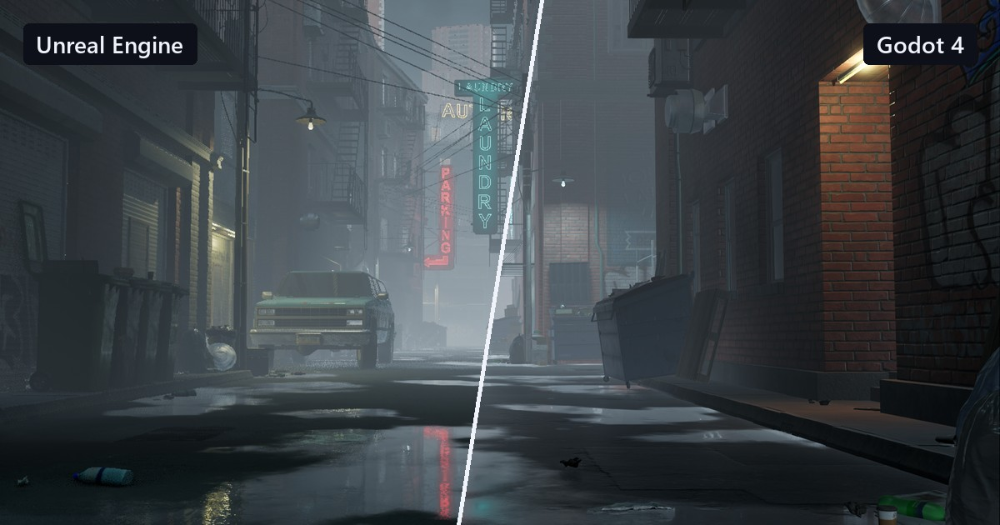

# Unreal Engine to Godot Asset & Level Exporter

A toolchain for migrating 3D asset packs and level layouts—static and skeletal meshes, collision shapes, PBR materials, lighting, decals, landscapes, foliage, and navigation—from **Unreal Engine** to **Godot Engine 4**.



> **What this is for:** Moving **3D asset packs you own** out of Unreal and into Godot with their meshes, materials, textures, collisions, and level layout intact.
>
> **What it is not:** A full project converter. Gameplay logic, Blueprint graphs, and engine systems do not transfer by design—see [Scope: What Transfers & What Doesn't](#scope-what-transfers--what-doesnt) before starting.

### Quick Navigation

[Compatibility](#engine-compatibility) · [Features](#key-features) · [Project Structure](#project-structure) · [Installation](#installation--setup) · [How to Use](#how-to-use) · [Scope](#scope-what-transfers--what-doesnt) · [Troubleshooting](#troubleshooting) · [Schema & Extending](#schema--extending) · [Support](#support)

---

## Architecture Overview

The repository contains two paired components that share a versioned JSON layout schema:

1. **Unreal to Godot Exporter (Unreal Plugin)** — A Python plugin running inside Unreal Engine with a thread-safe Tkinter GUI to batch-export meshes to glTF, textures to PNG (float art to EXR), landscapes to EXR, and level layouts to JSON (or directly to `.tscn`).
2. **Unreal Layout Importer (Godot Addon)** — A GDScript editor dock that parses the layout JSON, instances exported glTF assets at remapped transforms, generates physics collisions, binds PBR materials, and rebuilds lighting, terrain, foliage, decals, and navigation.

---

## Engine Compatibility

| Engine | Tested Version | Requirements & Notes |
| --- | --- | --- |
| **Unreal Engine** | **5.7 – 5.8** | Confirmed against the same landscape and material test suite (landscape APIs behave identically on both). Earlier 5.x versions are **untested**, though version-specific APIs are probed at runtime rather than assumed—if you test an older version, [let us know on Discord](https://discord.com/invite/HGwkYW2h6Y). Requires built-in **Python Editor Script Plugin**, **Editor Scripting Utilities**, and **glTF Exporter**. |
| **Godot Engine** | **4.7.1 – 4.7.2** | **Godot 4.4+** is expected to work, but only the versions listed here are tested. |

Both plugins stamp and verify a schema `format_version`. A mismatched plugin/addon pair fails immediately with a message telling you which side to update, rather than breaking halfway through an import.

---

## Key Features

### Geometry, Transforms & Scene Organization

- **Coordinate & Scale Conversion** — Automatically converts Unreal's left-handed Z-up (centimeter) space into Godot's right-handed Y-up (meter) space.
- **Batch Mesh glTF Export & LOD Chains** — Exports selected meshes or every mesh used in the active level to glTF (with optional `_LOD<n>.gltf` chains and per-LOD screen-size switch distances wired into Godot's `visibility_range`), using deterministic `_<hash>` filenames when asset packs reuse mesh names.
- **Physics & Skeletal Ragdoll Extraction** — Converts Unreal static-mesh collision primitives (Boxes, Spheres, Capsules, and Convex Hulls) into `CollisionShape3D` nodes under `StaticBody3D` (baking non-uniform scale into shapes so Jolt never logs errors or averages axes), and rebuilds exported skeletal `UPhysicsAsset` (`_physics.json`) bodies onto `Skeleton3D` via `PhysicalBoneSimulator3D` + `PhysicalBone3D`.
- **Blueprint & Multi-Component Actors** — Reconstructs complex Blueprint actors as a parent `Node3D` with each component placed at its relative transform offset.
- **Clean, Grouped Scene Tree & Outliner Folders** — Organizes imported nodes into dedicated containers (`UnrealStaticMeshes`, `UnrealLights`, `UnrealDecals`, `UnrealReflectionProbes`, `UnrealCameras`, `UnrealAudio`, `UnrealFoliage`, and `UnrealNavigation`) and optionally mirrors Unreal's World Outliner folder hierarchy as nested `Node3D` groups.
- **Spline Meshes, Reflection Probes, Cameras & Ambient Audio** — Deforms `SplineMeshComponent` geometry along cubic Hermite curves (roads, pipes, cables), converts Box/Sphere reflection captures into `ReflectionProbe` nodes, exports `CameraActor`/`CineCameraActor` with exact horizontal FOV (`KEEP_WIDTH`), and optionally transfers `AmbientSound` / `SoundWave` (`.wav`) to `AudioStreamPlayer3D`.
- **Incremental Re-Import & Blueprint Prefabs** — Stamps stable Unreal actor IDs so re-importing into an existing scene can update transforms/metadata in place without duplicating nodes or wiping Godot scripts/children, and optionally extracts repeated multi-component Blueprints into shared `res://prefabs/*.tscn` sub-scenes.

### Materials, Lighting & Atmosphere

- **PBR Material & Texture Binding** — Maps Unreal material parameters (albedo, normal, roughness, metallic, ORM/RMA, tiling, emissive, blend mode/alpha cutout, opacity masks, and two-sided culling) and auto-exported textures onto Godot `StandardMaterial3D` / `ORMMaterial3D` resources with case-insensitive file matching, non-destructive DirectX → OpenGL normal-map Y-flipping, and optional reusable `.tres` material saving.
- **Lighting & Post-Processing** — Converts every light component (including lights nested inside Blueprint props, not only standalone light actors) into `DirectionalLight3D`, `OmniLight3D`, or `SpotLight3D`. Carries unit-normalized intensity (lumens, candela, unitless, EV, nits), linear color, cone angles, source size, specular/volumetric scattering, shadow distance, distance fade, and visibility. Translates `PostProcessVolume`, height fog, and sky settings into a Godot `WorldEnvironment` (bloom, SSAO, exposure, fog, sky, and color temperature).
- **Decals** — Exports every decal component (including those on Blueprint props) as Godot `Decal` nodes preserving bounds, orientation, textures, atlas crops, tint/opacity, visibility, sorting priority, and distance fade.

### Environments, Foliage & Gameplay Data

- **Landscape / Terrain Migration** — Exports Landscape heightmaps and paint-layer weightmaps as float EXR images and rebuilds them using [Terrain3D](https://github.com/TokisanGames/Terrain3D) (recommended) or a plugin-free mesh fallback. Because Unreal's GPU landscape export silently writes empty images on landscapes without edit layers (common in asset packs), the exporter validates GPU readbacks and automatically falls back to CPU sampling of the landscape's collision heightfield and paint layers.
- **Foliage as MultiMesh** — Exports painted foliage, HISM, and ISM instances as packed transform arrays and rebuilds them as performant `MultiMeshInstance3D` nodes, retaining visibility, shadow casting, per-instance cull distances (as Godot visibility ranges with matching fade), and material overrides.
- **Navigation Volumes** — Converts `NavMeshBoundsVolume` actors into `NavigationRegion3D` nodes with matching agent settings and optional auto-baking on import.
- **Tags & Metadata** — Copies actor tags, component tags, and (best-effort) Blueprint variables onto Godot nodes as metadata readable via `get_meta()`.

### Workflow & Tooling

- **Direct `.tscn` Generation** — Optionally writes a ready-to-open Godot 4 scene file directly from Unreal without needing to run the importer dock.
- **Granular Controls** — Every feature has its own toggle on both the Unreal exporter GUI and the Godot importer dock, with persisted settings and descriptive tooltips.
- **Thread-Safe Unreal GUI** — Uses a queue-based architecture so the Tkinter interface stays responsive without locking up the Unreal Editor.

---

## Project Structure

```text
.
├── addons/
│   └── unreal_importer/                      # Godot Importer Addon
│       ├── import_unreal_layout.gd           # Core import orchestrator
│       ├── import_common.gd                  # Shared helpers (transforms, file lookup)
│       ├── import_environment.gd             # Lights, WorldEnvironment, decals
│       ├── import_terrain.gd                 # Landscape rebuild (Terrain3D / mesh fallback)
│       ├── import_foliage.gd                 # MultiMesh foliage rebuild
│       ├── import_gameplay.gd                # Navigation regions + node metadata
│       ├── import_skeletal_physics.gd        # Physics asset -> PhysicalBone3D ragdolls
│       ├── import_spline_mesh.gd             # Spline mesh deformation
│       ├── import_vertex_paint.gd            # Per-placement vertex paint
│       ├── import_report.gd                  # Import audit report writer
│       ├── texture_import_limit.gd           # Texture resolution cap & disk shrinking
│       ├── importer_dock.gd                  # Editor dock GUI & feature toggles
│       ├── plugin.cfg                        # Addon configuration
│       └── unreal_importer.gd                # Addon activation script
├── UnrealToGodot/                            # Unreal Engine Plugin
│   ├── Content/
│   │   └── Python/
│   │       ├── export_level_to_json.py       # Level parser & JSON exporter (orchestrator)
│   │       ├── export_static_meshes_to_gltf.py # glTF mesh & texture exporter
│   │       ├── export_environment.py         # Lights, post-process, fog, sky, decals
│   │       ├── export_landscape.py           # Landscape heightmaps & splatmaps
│   │       ├── export_foliage.py             # Foliage/ISM/HISM packed instances
│   │       ├── export_gameplay.py            # Nav volumes, tags, Blueprint variables
│   │       ├── tscn_writer.py                # Direct Godot .tscn scene generation
│   │       ├── ue2g_common.py                # Shared conversion math
│   │       ├── material_shader.py            # Vertex-painted materials to Godot shaders
│   │       ├── ue2g_diagnose.py              # Post-export self-audit module
│   │       ├── init_unreal.py                # Startup script (registers Window menu entry)
│   │       └── unreal_to_godot_gui.py        # Thread-safe Tkinter GUI
│   └── UnrealToGodot.uplugin                 # Unreal plugin descriptor
├── tools/
│   └── ue2g_diagnose.py                      # Standalone CLI diagnostic tool
└── docs/
    ├── SCHEMA_V2.md                          # Layout JSON schema & module contracts
    └── texture-sizing.md                     # Technical notes on why texture sizing lives in Godot
```

---

## Installation & Setup

### 1. Unreal Engine Plugin

1. Copy the `UnrealToGodot` folder into your Unreal project's `Plugins/` directory (create `Plugins/` in your project root if it does not exist).
2. Open your Unreal project.
3. Open **Edit > Plugins** and ensure all four plugins are enabled:
   - **Unreal to Godot Exporter**
   - **Python Editor Script Plugin** *(built-in)*
   - **Editor Scripting Utilities** *(built-in)*
   - **glTF Exporter** *(built-in)*
4. Restart the Unreal Editor.
5. Open the exporter anytime from **Window > Unreal to Godot Exporter**.

### 2. Godot Engine Addon

1. Copy the `addons/unreal_importer` folder into your Godot project's `addons/` directory.
2. Open your Godot project.
3. Open **Project > Project Settings > Plugins** and enable **Unreal Engine Layout Importer**.
4. A new **Unreal Importer** dock tab will appear in the bottom-right editor panel (next to the Inspector).

---

## How to Use

### Step 1: Export from Unreal Engine

1. Open the level you want to migrate in Unreal Engine.
2. Launch **Window > Unreal to Godot Exporter**.
3. Configure your output paths:
   - **glTF target folder** (defaults to `Saved/Exports/GLTF`)
   - **Layout JSON path**
   *(Heightmaps/weightmaps write to a sibling `terrain/` folder; textures write to `textures/`.)*
4. Toggle your desired **Level Export Features** (persisted across sessions):
   - **Lights & Post-Process**, **Decals**, **Landscape / Terrain**, **Foliage & Instances**, **Navigation Volumes**, **Tags & Metadata**, **Reflection Probes**, **Cameras**, and **Ambient Audio**.
   - **Foliage & Instances note:** Unticking this does *not* drop instanced geometry. Instead, each ISM/HISM instance exports as an individual mesh placement so architectural details (railings, window frames) still arrive—just unbatched. Keep it enabled for dense painted foliage so it batches cleanly into a `MultiMeshInstance3D`.
   - **Generate Godot `.tscn` scene directly** *(optional)*: Writes a ready-to-open scene file directly into your Godot project (requires setting **Godot Project Path** under *Godot Engine Integration*).
5. Click **Export Everything (Meshes + Layout)**.

> [!TIP]
> **Prefer "Export Everything (Meshes + Layout)" over running halves separately.**
> The layout JSON references exact mesh filenames written by the mesh exporter. Running the two actions separately makes it easy for exports to drift out of sync—causing missing textures or `_MISSING_` placeholders later in Godot. Exporting together also encodes each shared texture once instead of twice, dramatically cutting export times on real levels.
>
> Individual actions (**Batch Export All Level Meshes**, **Export Selected Meshes**, and **Export Level Layout only**) remain available when needed; just make sure both halves are up to date before importing.

> [!IMPORTANT]
> **Keeping textures light (avoiding Godot OOM crashes)**
> Unreal exports full-resolution source art, so a full level can easily produce several gigabytes of 4K PNGs—enough to make Godot's importer run out of memory and crash mid-import. Because Unreal's Python API cannot resize source art ([technical explanation](docs/texture-sizing.md)), texture sizing is handled in the **Godot Importer dock**:
> - **Texture size limit** *(default: `1024`)* — Caps the resolution Godot imports textures at, applying to both newly exported and already-imported textures.
> - **Also shrink texture files on disk** — Rewrites oversized PNGs named in the layout JSON down to the capped size, shrinking multi-gigabyte 4K exports down to a few hundred megabytes. **This is destructive**: the full-resolution originals remain only in Unreal, so raising the limit later requires re-exporting.

### Step 2: Import into Godot

1. Open or create a 3D scene in Godot to serve as the target root level.
2. In the **Unreal Importer** dock, set:
   - **Layout JSON File** — Path to the exported layout `.json`.
   - **glTF Models Folder** — Folder containing exported `.gltf` / `.glb` meshes.
   - **Textures Folder** — Folder containing exported textures (if any).
3. Expand **Import Features** to customize the import as needed:
   - Toggle Lights, World Environment, Decals, Terrain (**Auto / Terrain3D / HTerrain / Mesh fallback**), Foliage, Navigation Regions (with optional immediate baking), and Tags & Metadata.
   - *(Optional)* Enable **GDScript Coordinate Swap** only if you want Godot to recalculate transforms from raw coordinates (leaving it off uses pre-calculated JSON transforms, which is recommended).
   - Tune **Light energy scale** if the scene looks too bright or dark, or **Min decal depth (m)** if thin Unreal decal boxes clip unevenly on textured surfaces.
4. Set your **Texture size limit** and whether to **Also shrink texture files on disk**.
5. Click **Import Unreal Level Layout**.

### Optional: Direct `.tscn` Workflow

If you enabled **Generate Godot `.tscn` scene directly** during export, open the generated `.tscn` file in Godot directly. Two quick follow-ups apply:

- **Foliage:** Click **Bind Foliage Meshes (`.tscn` scenes)** once in the Unreal Importer dock. Because `.tscn` files cannot directly reference meshes nested inside glTF scenes, this binds each foliage MultiMesh in place using its `source_model` metadata.
- **Landscapes:** Landscapes appear as placeholder `Node3D` nodes storing the heightmap/weightmap metadata (a text scene cannot decode float EXRs into geometry). Run a dock import with only **Terrain** enabled to build them, or import the `terrain/*.exr` files directly through your terrain plugin.

The direct scene uses the materials inside the glTF files, so it does not carry per-placement material overrides, packed roughness/metallic maps, texture tiling, decal atlas crops, vertex paint, LOD chains, spline bending, or per-mesh shadow and draw-distance settings. For those, import the layout JSON through the dock instead.

---

## Scope: What Transfers & What Doesn't

This tool migrates **art**, not **behavior**. Typical environment, prop, and modular building packs transfer cleanly. Dense, heavily authored scenes—such as sprawling city kits or packs relying heavily on custom master-material shaders—will require more manual polish.

| Category | Status | Summary |
| --- | --- | --- |
| **Static & skeletal meshes, collision shapes, level layout, Blueprint actor hierarchy** | Transfers well | Positions, rotations, non-uniform scales, and relative offsets come across cleanly. |
| **Lights, sky/fog/post-process, decals, foliage (MultiMesh), navigation volumes, tags** | Transfers well | Mapped to native Godot 4 nodes and `get_meta()` metadata. |
| **PBR materials, lighting calibration, Nanite meshes, landscape materials, cameras, ambient audio (Sound Waves)** | Approximate | Expect minor manual tuning—details below. |
| **Blueprint graphs, gameplay systems, AnimBlueprints, particles, Sound Cue logic** | Out of scope | Not converted by design; rebuild behavior in GDScript. |

### Transfers Approximately (Expect Some Manual Work)

- **Materials (parameter-level, not shader-graph-level):** Albedo, normal, and packed maps along with scalar, vector, and tiling parameters rebuild as Godot `StandardMaterial3D` / `ORMMaterial3D`. On UE 5.8 the exporter reads the material graph to see which texture channel drives which output; older engines go by parameter and texture names. Custom shader graph logic—HLSL nodes, hue shifts, blends of several textures, world-position offset, or parallax—has no automatic equivalent and must be reauthored. The exception is materials that blend layers by vertex paint (puddles, moss): on UE 5.8 their graph is translated to a Godot shader and the paint comes along, as long as the graph uses common nodes and Unreal's Geometry Script plugin is enabled. Paint on instanced meshes and Blueprint prefabs is not carried.
- **Lighting (calibrated, not identical):** Unreal (lumens/candela/lux, Lumen) and Godot (energy, SDFGI/VoxelGI) use fundamentally different lighting and tonemapping pipelines. Local lights are matched photometrically in candelas. The sky is captured from the open level on export, and levels that use Lumen import with SDFGI and screen-space reflections on (Forward+ only; turn them off on the `WorldEnvironment` if they cost too much). Use **Light energy scale** for a quick global pass; raw Unreal intensities, units, and normalized candela values are also stored in the JSON if you want to build a custom mapping.
- **Nanite meshes:** Godot has no Nanite equivalent. Nanite assets export as standard triangle meshes at their available LODs; packs authored assuming Nanite polygon budgets may need decimation.

### Out of Scope by Design

- **Gameplay logic & systems:** Blueprint event graphs, gameplay frameworks, AnimBlueprints, and animation state machines do not convert and are not planned in the near term. Blueprint *actors* still transfer with their meshes, relative offsets, and (where exposed by Unreal's Python API) variables as node metadata so you have the scene structure ready to script against in GDScript.
- **Other unexported types:** Niagara/Cascade particle systems and Sound Cue graphs are not exported.
- **Animations:** Raw animation *sequences* can be embedded in glTF via **Export Animation Sequences (Skeletal Meshes)**, though the logic driving them cannot.

### Landscapes: Install Terrain3D

Heightmaps and paint-layer weightmaps export as float EXRs, and the terrain surface, collision, and a splat material are rebuilt automatically.

- **Recommended plugin:** For anything beyond a quick preview, install [Terrain3D](https://github.com/TokisanGames/Terrain3D) (`1.x` and `0.9.x` are both supported) and set Terrain mode to **Auto** or **Terrain3D**. Terrain3D preserves full exported heightmap resolution, whereas the plugin-free mesh fallback caps detail at a `257×257` grid.
- **Paint layer materials:** Unreal's terrain look lives inside a layer-blend shader graph, and Python cannot read which texture maps to which paint layer (layers are often named simply `1`, `2`, `3`). The importer builds a splat material tinted with each layer's Unreal debug color and exposes `layer0..3_albedo` slots—drop your ground textures into those slots and set the matching tints to white. Terrain3D users can alternatively wire the exported `terrain/*.exr` weightmaps into a `Terrain3DAssets` resource.
- **Known limits:** The built-in splat material blends the first **4** paint layers (additional layers still export). When Unreal's GPU landscape export fails—the normal case for asset-pack terrain—the CPU fallback samples at `513×513` for heightmaps and `129×129` for weightmaps by default. Both grid sizes can be raised in the exporter GUI at the cost of longer export times. If you hit an edge case, please [open an issue](https://github.com/vortechU/UnrealToGodot/issues).

### Workflow Boundaries

- **Only loaded levels are exported (with diagnostics):** The exporter reads actors from the currently loaded world and now inspects World Partition / streaming sublevels, warning in `ue2g_report.txt` and the dock preview whenever unloaded sublevels or World Partition cells are detected.
- **Incremental re-import:** Enable **Update existing scene (incremental)** in the Godot importer dock to match actors by `unreal_actor_id` and update them in place (preserving custom Godot scripts and children), with optional pruning of removed actors. Lights, decals, probes, cameras, audio, foliage, and navigation are rebuilt on each update, so edits to those generated nodes are lost unless the node has a script or children of its own (then it is kept as is); nodes you add to their containers stay. An existing WorldEnvironment or terrain is left alone. An actor whose components, mesh, collision, shadows, or material overrides changed in Unreal is rebuilt around your additions: child nodes, scripts, groups, and saved signal connections stay, edits to the imported nodes themselves do not. Material parameters edited in Unreal only reach existing actors on a fresh import. Leave it off for a clean one-shot import into a fresh scene.

---

## Troubleshooting

### Start Here: Read the Automated Reports

Both halves of the toolchain audit their own output automatically:

- **After export (`ue2g_report.txt`):** Written next to your export, with issues also surfaced in the GUI status bar and Unreal's Output Log prefixed `EXPORT CHECK:`. Catches stale glTFs from older runs, broken texture URIs, meshes referenced by the layout that were never exported, out-of-range material scalars, and oversized texture sets.
- **After import (`res://ue2g_import_report.txt`):** Written to your Godot project root, summarizing bound material maps, missing textures, and any failures—even if the import aborts early.

You can also re-run the export audit anytime from a **system terminal** (PowerShell, Command Prompt, or bash—*not* Unreal's Python console, which interprets arguments as a script filename):

```bash
python tools/ue2g_diagnose.py <export_folder>

# Optionally cross-check against your Godot project as well:
python tools/ue2g_diagnose.py <export_folder> --godot-project <godot_project>
```

The diagnostic script requires only standard Python (no Unreal or Godot installation needed).

### Common Issues

- **`Can't open file from path 'res://models/<Material>_<Mesh>_BaseColor.png'`**
  Those filenames come from Unreal glTF material *baking*, which this exporter disables—meaning stale `.gltf` files from an older export are still sitting in `models/`. Clear `models/`, re-run **Export Everything (Meshes + Layout)**, and delete Godot's `.godot/` cache folder so Godot does not serve cached old imports.
- **Godot crashes, hangs, or half-imports a large level**
  Full maps often export several gigabytes of 4K PNGs, causing Godot's WebP packer to run out of memory and crash mid-import (leaving a broken `.godot/` cache behind). Keep **Texture size limit** enabled (e.g., `1024` or `2048`) and **Also shrink texture files on disk** checked in the Godot importer dock before importing. Running `tools/ue2g_diagnose.py` warns you ahead of time if a texture set is dangerously large.
- **Exporter GUI window doesn't appear or locks up**
  Verify Tkinter is available in Unreal's embedded Python environment (standard Windows Unreal Engine installations include Tkinter by default).
- **Missing meshes (`_MISSING_<MeshName>` `Marker3D` placeholders)**
  The mesh name in the layout JSON did not match any `.gltf` file in your models folder. Confirm your **glTF Models Folder** path. If a pack contains multiple meshes with the same name, the exporter appends a deterministic `_<hash>` suffix—re-export meshes and layout together so filenames stay synchronized.
- **Textures aren't loading**
  Material and decal textures auto-export into a sibling `textures/` folder. Matching is case-insensitive and supports `.png`, `.tga`, `.jpg`, `.jpeg`, `.dds`, `.exr`, and `.webp`.
- **A few textures skipped with `"could not be written as PNG or EXR"`**
  Floating-point textures (imported from `.exr` or `.hdr`) export as `.exr`; everything else exports as `.png`. Cubemaps and sky panoramas have no single-image form and are safely skipped (the rest of the export succeeds and the report logs the skipped references). To include a skipped 2D texture, re-import it in Unreal from a `.png`, `.tga`, or `.exr`.
- **Imported scene is too dark or too bright**
  Adjust **Light energy scale** in the Godot importer dock or tweak individual light nodes. Original Unreal intensities and units are preserved in the layout JSON.
- **Terrain looks flat or missing**
  Terrain import requires the `terrain/*.exr` files alongside your layout JSON (or copied into the Godot project via auto-transfer). If `ue2g_import_report.txt` reports *no height variation*, re-export with the latest version so CPU heightfield fallback runs when Unreal's GPU export writes blank images. For full resolution beyond the `257×257` mesh fallback, install Terrain3D.
- **Foliage is invisible after opening a directly generated `.tscn`**
  Run **Bind Foliage Meshes (`.tscn` scenes)** from the Godot importer dock (see [Direct `.tscn` Workflow](#optional-direct-tscn-workflow)).
- **Blueprint variables missing from node metadata**
  Unreal's stock Python API only exposes Blueprint variables on certain engine versions; actor and component tags always export.

---

## Schema & Extending

The layout JSON schema and per-module contracts are documented in [docs/SCHEMA_V2.md](docs/SCHEMA_V2.md).

Each feature is implemented as an isolated Python exporter / GDScript importer module pair—removing a module cleanly disables that feature, and new features can be added following the same contract. Whenever you make an incompatible schema change, bump `format_version` in `export_level_to_json.py` and `SUPPORTED_FORMAT_VERSION` in `import_unreal_layout.gd` together.

---

## Support

- **Discord** — [Join the community server](https://discord.com/invite/HGwkYW2h6Y) for help, questions, and migration tips.
- **Bug Reports** — [Open a GitHub issue](https://github.com/vortechU/UnrealToGodot/issues) and attach both `ue2g_report.txt` and `res://ue2g_import_report.txt`—together they capture the full export/import run and save back-and-forth debugging.

Built by **Vordev** — [vortech.studio](https://www.vortech.studio/).

---

## License

MIT — see [LICENSE](LICENSE).

This license covers the **toolchain only**, not the assets you process with it. Asset packs retain their original licenses, and you are responsible for verifying that an asset pack's license permits use in another game engine before migrating it.
